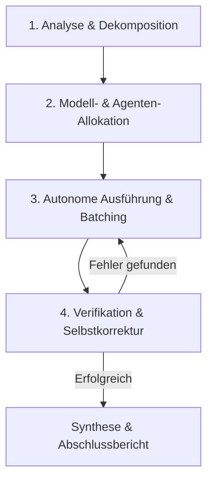

# Autonomous Model Orchestrator & Multi-Agent Planning Guide

Dieser Skill definiert das verbindliche Verhaltensmuster für Antigravity und T3 Code: Bei jedem eingehenden Prompt wird die Aufgabe automatisch strukturiert, in logische Schritte zerlegt, das am besten geeignete Modell für die Aufgabe und eventuelle Subagents/Delegates gewählt und die Umsetzung vollkommen selbstständig und zügig orchestriert.

---

## 1. Leitprinzipien der autonomen Orchestrierung

1. **Vollständige Handlungsautonomie**:
   - Warte nicht nach jedem Einzelschritt auf Bestätigung, wenn der Lösungsweg technisch eindeutig ist.
   - Treffe fundierte Annahmen im Sinne des Nutzers und setze sie direkt um.
   - Frage nur dann nach, wenn eine fundamentale Richtungsentscheidung unlösbare Zielkonflikte birgt.

2. **Modell-Präzision (Right Model for the Right Job)**:
   - Kein "One-Size-Fits-All": Verwende schnelle, ressourcenschonende Modelle für Standard-/Routineaufgaben und reserviere High-End-Reasoning-Modelle für algorithmisch und architektonisch anspruchsvolle Probleme.
   - Achte auf Kosten, Latenz, Kontextgröße und Reasoning-Tiefe.

3. **Effizientes Batching & Parallelität**:
   - Führe unabhängige Dateiabfragen, Suchen und Befehle in einem einzigen Aufruf bzw. Turn parallel aus.
   - Nutze Subagents und Workflows für modular trennbare Aufgaben (Recherche, parallele Analysen, Multi-Language-Audits).

4. **Eingebaute Verifikations- und Selbstheilungsschleife**:
   - Jeder Schritt wird vor Abschluss deterministisch validiert (Syntax, Build, Linter, fachliche Tests).
   - Treten Fehler auf, werden diese autonom analysiert, behoben und re-validiert.

---

## 2. Modell-Taxonomie & Entscheidungsmatrix

In der Umgebung stehen native Modelle via `invoke_subagent` sowie anbieterübergreifende Modelle via `delegate_task` zur Verfügung.

### Übersicht der Modell-Tiers

| Tier | Einsatzzweck & Komplexität | Native Subagent (`Model`) | T3 Provider & Model (`delegate_task`) | Merkmale & Stärken |
| :--- | :--- | :--- | :--- | :--- |
| **Tier 1: Fast / Routine / High-Volume** | - Schnelle Datei- & Textsuchen - Code-Formatierung & Linting - Einfache Dateimanipulationen - Metadaten- & Statusabfragen - Summaries & Extraktionen | `flash_lite`, `flash` | - `antigravity` / `gemini-3.8-flash` (`thought_level: low`) - `claudeAgent` / `claude-haiku-5-5` - `grok` / `grok-4.7-build-fast` - `opencode` / `opencode/beam-free` | Extrem schnell, minimale Latenz, kostengünstig, ideal für parallele Zuarbeit |
| **Tier 2: Balanced / Standard Development** | - Standard-Feature-Entwicklung - Refactoring von Modulen - SEO- & Content-Texterstellung - Lokalisierung / Übersetzungen - Unit- & Integrationstests schreiben | `flash`, `inherit` | - `antigravity` / `gemini-3.8-flash` (`thought_level: medium`) - `claudeAgent` / `claude-sonnet-5-5` (`effort: medium` oder `high`) - `antigravity` / `claude-sonnet-4-6` - `antigravity` / `gpt-oss-120b-medium` | Exzellente Code- und Textqualität, starkes semantisches Verständnis, solides Tool-Handling |
| **Tier 3: Frontier / Deep Reasoning & Architecture** | - Komplexe Systemarchitektur - Tiefes Debugging (Race Conditions, Concurrency) - High-Stakes Code Reviews & Sicherheitsaudits - Algorithmische Optimierung - Diffizile Problembehebungen | `pro` | - `claudeAgent` / `claude-opus-5-5` (`effort: high` bis `ultrathink`) - `codex` / `gpt-6-luna` (`reasoningEffort: high` / `xhigh`) - `antigravity` / `claude-opus-4-6-thinking` - `grok` / `grok-4.7` (`reasoningEffort: high`) | Höchste Reasoning-Leistung, akribische Fehleranalyse, beherrscht vielschichtige Abhängigkeiten |

---

## 3. Subagent- & Delegations-Routing

Wähle das Werkzeug passend zur Art der Delegation:

### A. Native Subagents (`invoke_subagent` / `define_subagent`)
Verwende native Subagents, wenn die Teilaufgabe innerhalb des aktuellen Workspace/Providers ausgeführt werden kann:
- **`self`**: Vollständige Tool- und Kontextvererbung (gleicher Provider, System-Prompt). Nutze `Model: "flash_lite"` oder `"flash"` für Routineauslagerung, `"pro"` für tiefere Analysen.
- **`research`**: Lese-Sandbox für reine Codebase- und Dokumentationsrecherchen ohne Schreibzugriffe oder Netzwerk-Overhead.
- **`image-generator`**: Generierung und Modifikation visueller Assets.
- **Dynamisch definierte Subagents (`define_subagent`)**: Für spezialisierte Rollen mit eigenem Systemprompt (z. B. "Hugo Validator Specialist", "Translation QA Auditor").

### B. T3 Code Provider-Delegation (`delegate_task`)
Verwende `delegate_task`, wenn:
- Ein Modell eines anderen Anbieters gezielt benötigt wird (z. B. `claudeAgent` / `claude-opus-5-5` oder `codex` / `gpt-6-luna`).
- Eine isolierte Arbeitskopie erforderlich ist (`isolation: "worktree"`).
- Aufgaben im Hintergrund laufen sollen, während die Hauptinstanz weiterarbeitet.

### C. Workflow-Orchestrierung (`run_workflow`)
- Wenn eine Aufgabe aus dutzenden gleichartigen Einzelschritten besteht (z. B. Audit aller 700+ Content-Dateien).
- Scriptbasierte Pipelines mit `agent`, `parallel`, `pipeline` und Aggregation.

---

## 4. Der 4-Phasen Autonome Ausführungszyklus (Bei jedem Prompt)

Bei jedem Prompt durchläuft der Agent systematisch diese vier Phasen:

### Phase 1: Analyse & Dekomposition
1. **Intention erfassen**: Was ist das ultimative Ziel des Nutzers?
2. **Umfang klassifizieren**:
   - *Micro* (1-2 Befehle, einfacher Edit) -> Direkt als Lead Agent ausführen.
   - *Medium* (Mehrere Dateien, lokales Feature, Validierung) -> Strukturierte Batch-Abarbeitung.
   - *Macro* (Großes Refactoring, Multi-Language-Updates, tiefe Analysen) -> Subagents / Parallelisierung einplanen.
3. **Abhängigkeiten identifizieren**: Welche Schritte blockieren einander, welche laufen parallel?

### Phase 2: Modell- & Agenten-Allokation
1. **Lead Agent Rolle**: Koordiniert, hält den globalen Überblick und führt kritische Dateizusammenführungen durch.
2. **Subagent-Slicing**:
   - Teile voneinander unabhängige Recherche- oder Prüfaufgaben ab.
   - Ordne jeder Teilaufgabe das passende Modell-Tier zu (siehe Matrix).
   - Formuliere eindeutige, zielgerichtete Prompts für Subagents (inkl. Definition of Done).

### Phase 3: Autonome Ausführung & Tool-Batching
1. **Parallele Tool-Calls**: Führe alle unabhängigen Lese-, Schreib- und Suchoperationen im selben Turn aus.
2. **Keine künstlichen Pausen**: Sobald ein Zwischenergebnis vorliegt, direkt den nächsten Schritt anschließen.
3. **Sorgfalt bei Code- und Inhaltsänderungen**: Edits präzise und zielgenau vornehmen (z. B. UTF-8, Erhalt von Formatierungen).

### Phase 4: Verifikation & Selbstkorrektur
1. **Validierungsbefehle ausführen**:
   - Bei Content/SEO: `python -X utf8 scripts/validate_content.py` und `python -X utf8 scripts/validate_seo.py`.
   - Bei Code: Tests, Build-Befehle oder Typprüfungen.
2. **Fehlerbehandlung**: Schlägt ein Check fehl, nicht den Nutzer fragen – Ursache analysieren, fixen und erneut testen.
3. **Transparenter Abschlussbericht**:
   - Geänderte / erstellte Dateien als anklickbare Links `[dateiname](file:///...)`.
   - Eingesetzte Modelle & Agenten (warum welches Modell gewählt wurde).
   - Validierungsergebnisse.

---

## 5. Konkrete Entscheidungsbäume für typische Aufgaben

### Fall A: Schnelle Korrektur / Lokaler Bugfix
- **Modell-Tier**: Tier 1 (Fast) oder aktuelles Modell (`gemini-3.8-flash`).
- **Orchestrierung**: Direkt im Hauptturn: Read -> Edit -> Test -> Done.
- **Rückfragen**: Keine.

### Fall B: Neues Feature / Tiefes Refactoring
- **Planung**: Phase 1 Analyse -> Phasenplan aufstellen.
- **Modell-Tier**: Tier 2 (Standard/Balanced) für Codeerstellung; Tier 3 (Frontier, z. B. `claude-opus-5-5` oder `pro`) für Architekturreviews komplexer Datenstrukturen.
- **Orchestrierung**: Autonome Umsetzung, anschließender Testlauf.

### Fall C: Mehrsprachige Content-Generierung & Validierung
- **Modell-Tier**: Tier 2 für hochwertige Textübersetzung und Lokalisierung unter Einhaltung aller SEO/GEO-Kriterien.
- **Orchestrierung**:
  1. English canonical lesen (`content/docs/<slug>.md`).
  2. Zielübersetzungen erstellen (`.de.md`, `.pt.md`, `.es.md`, `.ja.md`).
  3. Hugo Production Build & Validatoren ausführen.
  4. Baseline prüfen und Bericht ausgeben.
